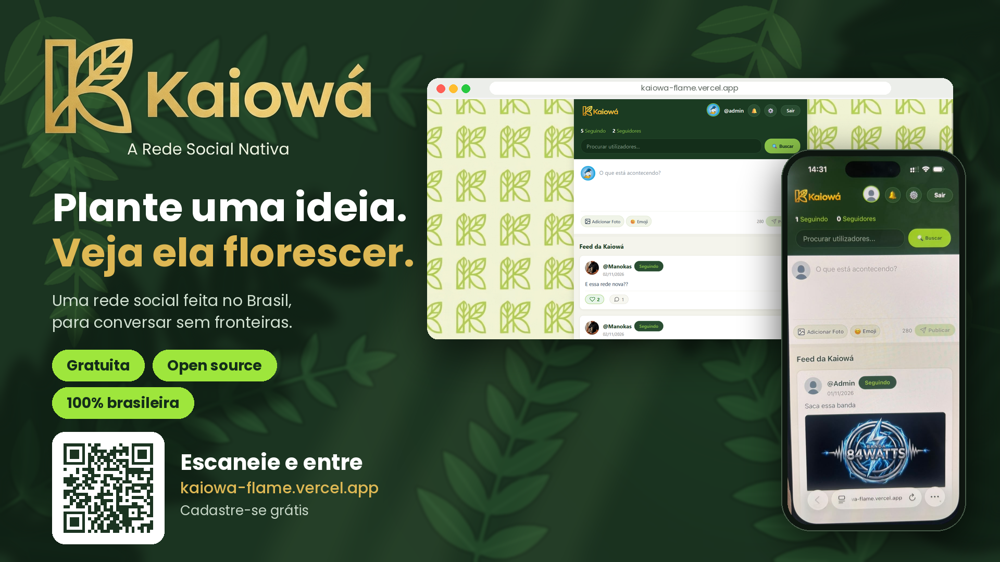

<div align="center">
  
  
  <br/><br/>

  # 🌱 Kaiowá - A Rede Social Nativa

  **Plante uma ideia. Veja ela florescer.**  
  *Uma rede social open-source feita no Brasil, para conversar sem fronteiras.*

  [](https://kaiowa-flame.vercel.app)
  [](https://kaiowa-api.onrender.com)
  [](https://supabase.com)
  [](LICENSE)

  [🌐 Acessar Aplicação](https://kaiowa-flame.vercel.app) • [🐛 Reportar Bug](https://github.com/seu-usuario/kaiowa/issues) • [📜 Documentação](#-estrutura-do-projeto)
</div>

---

## 📌 Sobre o Projeto

O **Kaiowá** é uma plataforma de rede social completa e *open-source*, desenhada para unir simplicidade, desempenho e segurança. O projeto adota uma arquitetura descentralizada com um frontend rápido em **React/Vite**, uma API RESTful robusta em **Node.js/Express**, e armazenamento relacional e de mídias com **Supabase (PostgreSQL & Storage)**.

---

## 🚀 Funcionalidades

- 🔐 **Autenticação Segura:** Cadastro, login e alteração de senha com criptografia **bcrypt** e tokens de sessão.
- 📝 **Feed Dinâmico:** Publicação de posts contendo texto e imagens.
- 💬 **Comentários & Reações:** Sistema de interações em publicações com emojis e comentários em tempo real.
- ❤️ **Curtidas & Seguidores:** Sistema de conexões entre usuários e contagem estatística de perfil.
- 🔔 **Notificações:** Alertas de interações, seguidores e comentários.
- 🖼️ **Upload de Mídia:** Armazenamento seguro de avatares e mídias via Supabase Storage.

---

## 🛠️ Tecnologias Utilizadas

### Frontend (`/kaiowa-web`)
- **React** + **Vite**
- **CSS3 / Styled Components**
- **Lucide / FontAwesome Icons**

### Backend (`/kaiowa-api`)
- **Node.js** + **Express**
- **bcrypt** (Criptografia de senhas)
- **Multer** (Processamento de uploads em memória)
- **CORS** & **Environment Variables (`dotenv`)**

### Banco de Dados & Infraestrutura
- **Supabase PostgreSQL** (Banco de Dados Relacional)
- **Supabase Storage** (Armazenamento de imagens)
- **Vercel** (Hospedagem Frontend)
- **Render** (Hospedagem API Backend)

---

## 📂 Estrutura do Repositório

```text
kaiowa/
├── kaiowa-api/             # Backend (Node.js & Express API)
│   ├── index.js            # Servidor principal e rotas
│   ├── database.js         # Conexão PostgreSQL / Supabase
│   └── package.json
│
├── kaiowa-web/             # Frontend (React + Vite)
│   ├── src/                # Componentes e páginas
│   └── package.json
│
├── public/                 # Assets do repositório (Banners e Logos)
│   └── banner-kaiowa.png
│
├── README.md               # Documentação do projeto
└── .gitignore